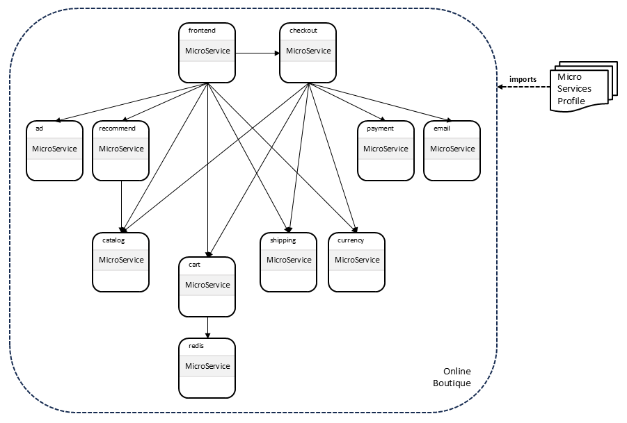

# Online Boutique

The [Online
Boutique](https://github.com/GoogleCloudPlatform/microservices-demo)
example defines a web-based e-commerce app where users can browse
items, add them to the cart, and purchase them. It consists of 11
microservices that communicate using gRPC, as shown in the following
figure:

The GoogleCloudPlatform github repository includes a single
[Kubernetes
Manifest](https://github.com/GoogleCloudPlatform/microservices-demo/blob/main/release/kubernetes-manifests.yaml)
that can be used to deploy the entire microservice.

This directory defines a TOSCA service template that models the online
boutique and that can be used to deploy the service. The following
figure shows its microservices and how they interact:

The service template, [`main.yaml`](main.yaml), imports the [abstract
application profile](../../profiles/community/tosca/abstract/application/profile.yaml)
and the [abstract platform
profile](../../profiles/community/tosca/abstract/platform/profile.yaml).
Every microservice is a `MicroService` node hosted on a single `cluster`
node of type `ContainerPlatform`. Every node carries `technology` and
`implementation-details`, and the implementation details are taken as
inputs, one per node, which the template passes to the substituting
template unchanged.

Each node is annotated with the `substitute` directive and is intended
to be *realized* by a substituting template. The [substituting template
for `MicroService` nodes](../substitutions/microservice/main.yaml) is one
such realization.

## What a microservice's endpoint carries

What the `Endpoint` capability of a microservice should carry is not
decided (community issue I56), so the directory holds the template in
two forms:

- [`main.yaml`](main.yaml) assigns `Endpoint` as the `0.2` application
  profile defines it: a `port`, a `target-port` and a `name` on every
  microservice. The values are those of a Kubernetes Service: `frontend`
  exposes port 80 and forwards it to container port 8080, and `email`
  exposes 5000 and forwards it to 8080.
- [`main-endpoint-url.yaml`](main-endpoint-url.yaml) gives `Endpoint` a
  single `url` in their place, as the platform types give their
  management address one. The scheme says how the service is reached,
  `grpc`, `http` or `redis`, and the port is the one its consumers
  connect to, so `frontend` is `http://:80` and `email` is
  `grpc://:5000`. The host is left out, since it is known only once the
  service is deployed. The container port behind it belongs to the
  realization and travels as `target-port` in each microservice's
  `implementation-details`, whose values are in
  [`inputs/main-endpoint-url.yaml`](inputs/main-endpoint-url.yaml). This
  form does not validate against the `0.2` profile, whose `Endpoint` has
  no `url`.

*The `url` form was drafted with an AI assistant (Claude).*
