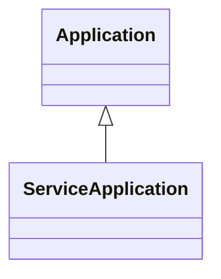

# TOSCA Community Application Profile

This profile defines types for deploying applications, derived from the abstract
`Application` node type in the [base profile](../base/README.md). It declares the
`ServiceApplication` node type and the `Endpoint` capability that specializes the
`Service` port every application has.

## ServiceApplication

An application that provides a service across the network, reached at the address its
`service` capability carries.

`ServiceApplication` derives from `Application` and refines its `service` capability to
type `Endpoint`. It narrows no requirement, so it keeps the `host` requirement that
`Application` inherits, targeting any platform. Placement is determined by:

- **Template assignment**: The `host` assignment in the template specifies which platform
  the application runs on, by naming a platform node or using a node filter.
- **Technology and product**: The application's `technology` and `product` properties
  determine how the application is realized.
- **Platform designation**: The platform is designated to be a certain kind
  (`ContainerPlatform`, `ServerPlatform`, `ServerlessPlatform`, etc.) by the template or
  realization layer.

For example, a `ServiceApplication` assigned to a `ContainerPlatform` with `technology:
kubernetes` is realized as Kubernetes resources; the same type assigned to a
`ServerPlatform` is realized as software installed on that server.

## Interaction between applications

Every application exposes a `service` capability of type `Service`, and reaches another
application's through an `interacts-with` requirement over `InteractsWith`; both are declared
on `Application` in the [base profile](../base/README.md). `InteractsWith` is an association,
so it asserts no deployment order.

A `ServiceApplication` refines its `service` capability to type `Endpoint`, which carries
an optional `url` property in place of the former `port`, `target-port`, `name`, and
`protocol` properties. The scheme in the `url` says how the service is reached (e.g.,
`http`, `grpc`), and the port is the one consumers connect to. The host is known only
once the service is deployed, so a template may give the scheme and port alone
(e.g., `grpc://:5050`), and the realization publishes the full address through the
attribute the property reflects. A container port behind the exposed one belongs to the
realization and travels in `implementation-details`.

Either end of an `interacts-with` relationship may be any kind of application, and a
profile that wants to restrict the sources narrows `valid_source_node_types` on the
capability.

## Endpoint

A service reached over a network, at the address its `url` property gives. It carries a
single optional `url` property that specifies the service location. Applications that
provide no service across the network use the base `Service` capability (without
`Endpoint`'s `url` property) to assert only that another application may interact with
them, without establishing a service contract.

