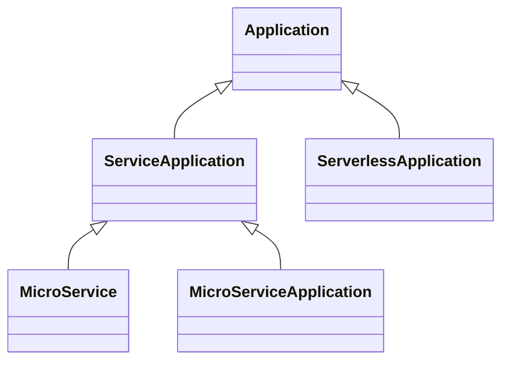

# The Abstract Application Types

*Drafted with an AI assistant (Claude); reviewed and submitted by Chris Lauwers.*

**Status:** Proposal — for discussion. Tracked as I58.
**Audience:** TOSCA Community.
**Purpose:** Distinguish the abstract application node types by what an application does and how
it is reached, rather than by the platform it is deployed on, so that placement is decided where
the template or the realization decides it.

**Related documents:** [application profile](../abstract/application/profile.yaml) and its
[README](../abstract/application/README.md) · [Online Boutique](../../../../examples/online_boutique) ·
[modeling-methodology](modeling-methodology.md)

---

## The types today

The application profile derives four node types from the base profile's `Application`, which
gives every application a `service` capability of type `Service` and an `interacts-with`
requirement.

| type | narrows `host` to | refines `service` to | otherwise adds |
|---|---|---|---|
| `MicroServiceApplication` | `ContainerPlatform` | — | nothing |
| `MicroService` | — | `Endpoint` | nothing |
| `ServerApplication` | `ServerPlatform` | `Endpoint` | nothing |
| `ServerlessApplication` | `ServerlessPlatform` | — | nothing |

The README describes them along two axes: whether a node stands for a whole application or for one
component of one, and which kind of platform it is deployed on.

## What is wrong with it

**The platform axis decides placement in the type.** Three of the four types differ from
`Application` only in the platform they accept. A System View template describes an application's
architecture, the components and how they interact; where each component runs is a placement
decision. Fixed in the type, it is taken from every template before a realization is selected, and
a component that could run on a cluster or as installed software on a server must be modelled twice
to say so.

**The profile and its README disagree.** The README says a `MicroService` is deployed on a
`ContainerPlatform`; the type narrows nothing.

**Software that serves nothing has no type.** `ServerApplication` is the only type for software on
a server, and its `Endpoint` requires ports, so a command-line tool or a batch job is given a
network contract it does not have, or falls back to `Application`.

**Two types add nothing but a platform.** With the platform gone, `MicroServiceApplication` and
`ServerlessApplication` would be `Application` under other names.

## The proposal

**Type an application by what it does and how it is reached. Leave where it runs to the template
and the realization.**

1. **No application type narrows `host`.** Every application keeps the `host` requirement it
   inherits, targeting any platform's `Host` capability. A template that must place a component
   says so in its `host` assignment, by naming a platform node or with a node filter; a realization
   is selected by the application's `technology` and `product`, and by what its platform is
   designated to be (I57).
2. **`ServiceApplication` replaces `ServerApplication`**: an application that provides a service
   across the network. It refines `service` to `Endpoint`. The proposal assumes `Endpoint` carries
   a single `url`, the third option of I56; if `Endpoint` is removed instead, `ServiceApplication`
   has nothing to add and collapses into `Application`.
3. **`MicroService` derives from `ServiceApplication`.** What it adds is a role: one component of a
   microservice application, substituted separately from its peers. A template that explodes an
   application into its microservices uses it.
4. **`MicroServiceApplication` derives from `ServiceApplication`.** It stands for a whole
   application known only to be built from microservices, realized as one unit, for example by a
   Helm chart or a manifest, with its internal topology left to the realization. It still exposes a
   service, as the Online Boutique's storefront is one.
5. **`ServerlessApplication` derives from `Application`.** A serverless application is invoked by
   events rather than serving on a port of its own, which is a programming model and not a platform
   choice, so it keeps the base `Service` and no platform.
6. **Everything else is an `Application`**, including software that serves nothing.
7. **`Service` stays as N11 left it, without properties.** Every application keeps the `service`
   capability `Application` declares, as the target of `interacts-with`. It asserts only that
   another application may interact with this one, and carries no contract: a function triggered
   by a queue, or two applications sharing a file, interact without an address a consumer could
   read. `Endpoint` is where a contract begins, so an application that serves nothing over the
   network carries the empty `service` and no false one. Putting the `url` on `Service` itself
   would give every application an address, including those that have none.



The profile would read:

```yaml
node_types:
  ServiceApplication:
    description: >-
      An application that provides a service across the network, reached at
      the address its service capability carries.
    derived_from: Application
    capabilities:
      service:
        type: Endpoint

  MicroService:
    description: >-
      A single microservice: one component of a microservice application,
      substituted separately from the other components.
    derived_from: ServiceApplication

  MicroServiceApplication:
    description: >-
      A whole microservice application, realized as one unit, whose
      internal topology is left to the substituting template.
    derived_from: ServiceApplication

  ServerlessApplication:
    description: >-
      An application invoked by events rather than serving on a port of
      its own.
    derived_from: Application
```

## Where placement goes

The revised Online Boutique already places every microservice explicitly: each assigns
`host: cluster`, a `ContainerPlatform` node, and sets `technology: kubernetes` for the realization
to select on. It is unchanged by the proposal.

A `ServiceApplication` whose `host` is assigned to a `ServerPlatform` is realized as software
installed on that server; the same type assigned to a `ContainerPlatform` is realized as a
container. The type says what the component is, the assignment says where it runs, and the
realization is selected from both.

## What changes for templates

The `0.2` may break templates, since no compatibility is promised before `1.0`:

- **`ServerApplication` goes.** A template using it retypes the node as `ServiceApplication`, or as
  `Application` if it serves nothing.
- **An unassigned `host` widens.** A `MicroServiceApplication` or `ServerlessApplication` whose
  template leaves `host` to be fulfilled was restricted by its type to one kind of platform, and
  would now accept any. A template relying on that restriction assigns `host` or adds a node
  filter.
- **`MicroService` templates are unchanged.** Its `host` was never narrowed, and the substituting
  templates in the repository match it by type, which stays.
- **The application profile README** loses its two-axis table, and describes the types as above.

## Open questions

- **Whether `MicroService` is a type or a role.** If the role adds no capability, requirement or
  property, it is one meaning under two names, and `ServiceApplication` would serve. Its value is
  that a realization can be selected by type for the microservice case.
- **Whether `MicroServiceApplication` and `MicroService` should differ.** Both would be
  `ServiceApplication`s; what tells them apart is whether a template explodes the application or
  treats it as one unit, which the template's structure already shows.
- **Whether a serverless application provides a service.** A function invoked over HTTP is reached
  at an address, which argues for `ServiceApplication`; one invoked by queue messages or storage
  events is not.
- **`ServiceApplication` as the name**, against `NetworkApplication` or `NetworkService`.

The proposal depends on I56, for what `Endpoint` carries, and on I57, for the platform property a
realization selects on.

## Decision sought

Adopt items 1 to 7 for the `0.2`: no application type narrows `host`; `ServiceApplication`
replaces `ServerApplication` and carries `Endpoint`; `MicroService` and `MicroServiceApplication`
derive from it; `ServerlessApplication` derives from `Application`; `Service` stays without
properties; and the README follows.
